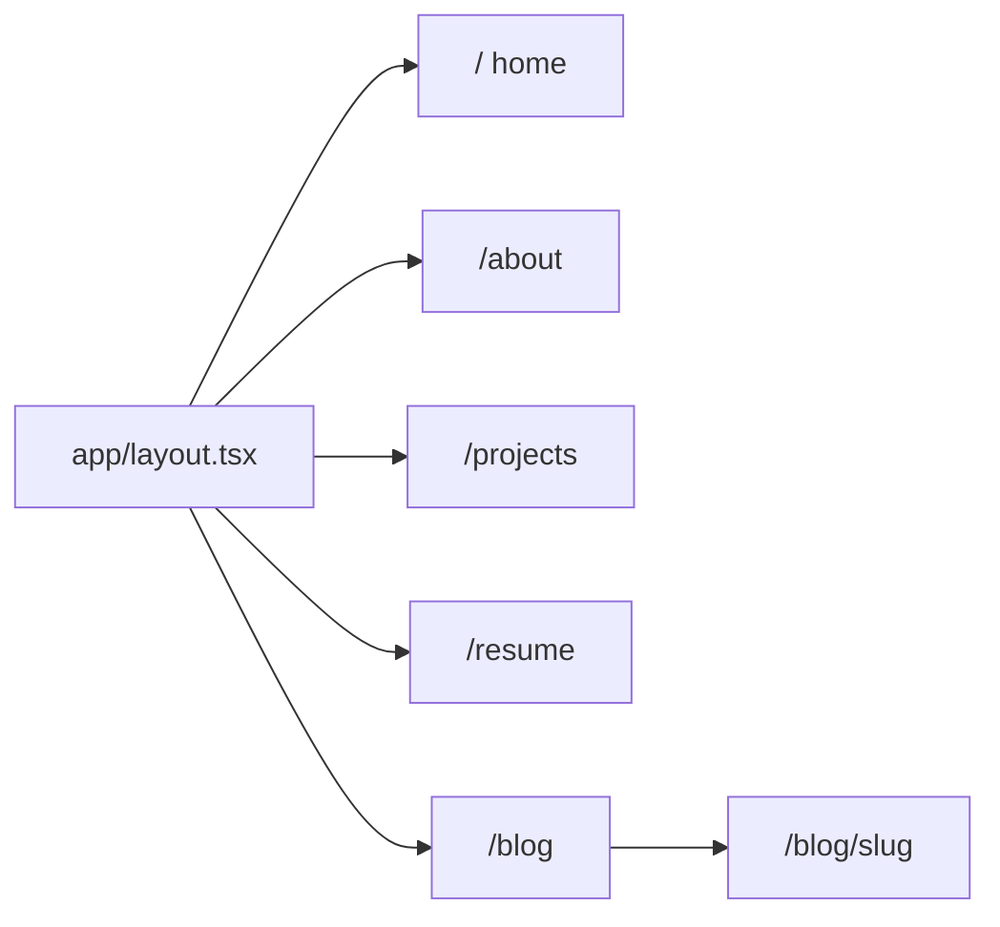

# Personal website scaffold

Replace the default Next.js 16 starter in [`app/page.tsx`](app/page.tsx) with a small multi-page site. Shared chrome lives in the root layout; section content lives on its own route. Blog posts stay hardcoded for now (no Markdown/MDX).

## Routing

- [`app/layout.tsx`](app/layout.tsx): keep fonts/metadata; wrap `{children}` with `Header` + `main` + `Footer`. Update `metadata.title` / `description` away from “Create Next App”.
- New pages: [`app/about/page.tsx`](app/about/page.tsx), [`app/projects/page.tsx`](app/projects/page.tsx), [`app/resume/page.tsx`](app/resume/page.tsx), [`app/blog/page.tsx`](app/blog/page.tsx), [`app/blog/[slug]/page.tsx`](app/blog/[slug]/page.tsx).
- Internal nav uses `next/link`. Home (`app/page.tsx`) becomes a short intro plus links into the four sections.

## Shared data and UI

- [`lib/site.ts`](lib/site.ts): name, tagline, GitHub/LinkedIn URLs (placeholders you can swap), nav items.
- [`lib/content.ts`](lib/content.ts): placeholder about copy, projects array, resume experience/education, 2–3 blog posts (`slug`, `title`, `date`, `excerpt`, `body`).
- [`components/Header.tsx`](components/Header.tsx): site name, nav (About / Projects / Resume / Blog), GitHub + LinkedIn (`<a target="_blank" rel="noopener noreferrer">`), theme toggle.
- [`components/Footer.tsx`](components/Footer.tsx): short copyright + the same social links.
- [`components/ThemeToggle.tsx`](components/ThemeToggle.tsx): `"use client"`; pages stay Server Components.

## Light / dark mode

Today [`app/globals.css`](app/globals.css) uses `@media (prefers-color-scheme: dark)` plus Tailwind `dark:` classes, so there is no toggle.

- Switch Tailwind v4 to class-based dark: `@custom-variant dark (&:where(.dark, .dark *));`
- Keep `--background` / `--foreground`; apply `.dark` on `<html>`.
- Persist preference in `localStorage`; fall back to system preference.
- Add a tiny inline script in the root layout so the first paint matches the saved theme (no flash). Default to system if unset.

No extra theme library; a small client toggle is enough.

## Page content (placeholders)

- **Home:** name, one-line role, links to the four sections.
- **About:** short bio + a few skill tags from `lib/content.ts`.
- **Projects:** card grid (title, description, tags, optional GitHub/demo links).
- **Resume:** experience, education, optional “Download PDF” pointing at `/resume.pdf` (add a note in the page if the file is not in `public/` yet).
- **Blog index:** list of placeholder posts.
- **Blog post:** look up by `slug` from the same array; `notFound()` if missing. Use Next 16 async params: `const { slug } = await params` with `PageProps<"/blog/[slug]">`.

Visual style: reuse Geist fonts and zinc/neutral Tailwind already in the starter; readable max-width (`max-w-3xl`) content column. Remove leftover Next/Vercel starter imagery and copy.

## Verify

- Run `npm run dev` if it is not already running.
- In the browser: home → each nav link, a blog post, GitHub/LinkedIn (external), theme toggle (persists on reload), and a quick desktop + narrow viewport check of the header.

You can fill real copy and URLs in `lib/site.ts` / `lib/content.ts` later without changing the layout.